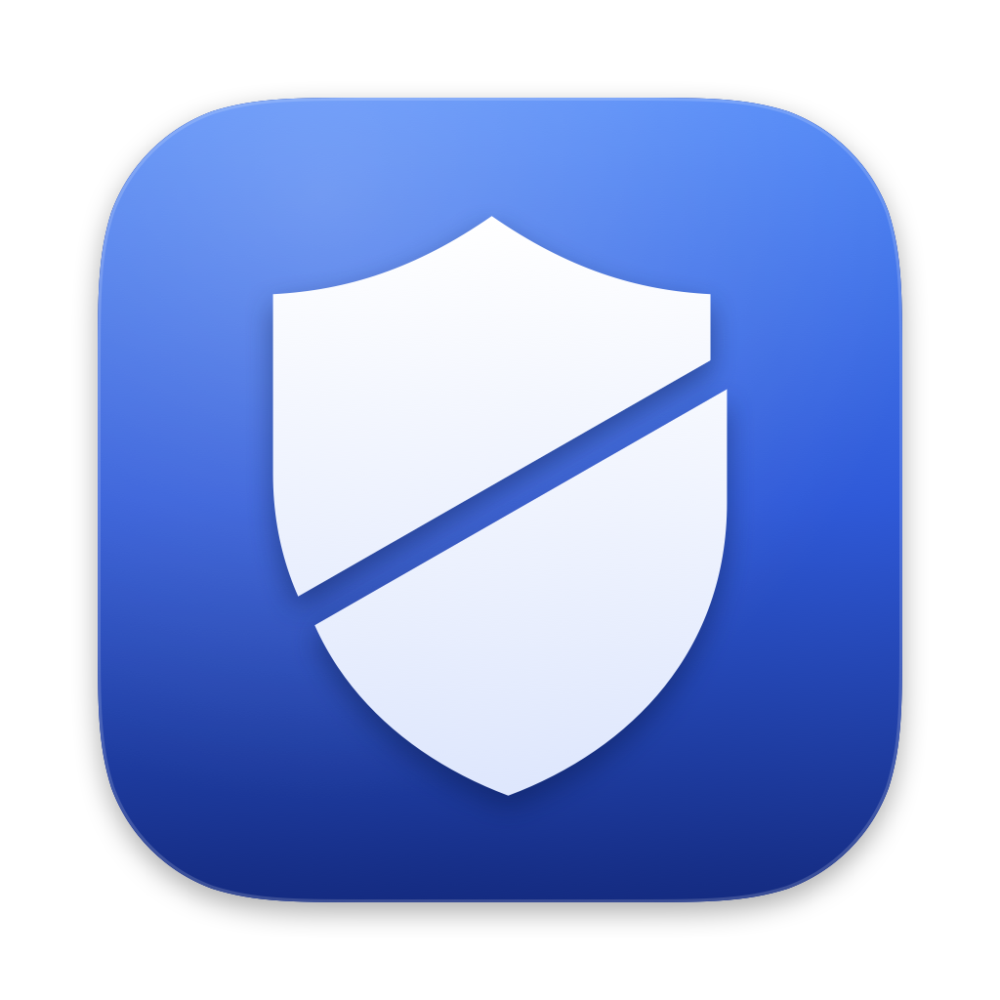

<p align="center">
  
</p>

<h1 align="center">DPI Kalkan</h1>

<p align="center">
  SNI tabanlı DPI engellerini aşan, macOS için menü çubuğu uygulaması.
</p>

DPI Kalkan, servis sağlayıcıların derin paket incelemesiyle (DPI) uyguladığı erişim engellerini aşar. Bu engeller TLS ClientHello paketindeki alan adına (SNI) bakar. Uygulama bir VPN değildir: trafiğin başka bir sunucuya gitmez, şifrelenmez ve hızın düşmez. Bilgisayarında yerel bir proxy çalışır ve her bağlantının ilk TLS paketini DPI'nin okuyamayacağı şekilde böler. Discord, Wattpad gibi siteler tarayıcıda da uygulamalarda da açılır.

## Özellikler

- **Sistem geneli:** Tarayıcılar ve Electron uygulamaları (Discord dahil) otomatik yapılandırma (PAC) ile, terminal araçları ve Discord güncelleyicisi ortam değişkenleriyle proxy'den geçer.
- **Kayıt başı bölme:** ClientHello'nun ilk TLS kaydı yalnızca 1 bayt taşır. Basit bölmenin yetmediği yerde de işe yarar.
- **Otomatik geri dönüş:** Bölmeyi kabul etmeyen sunucular için (ör. bazı bankalar) TCP segment bölmeye kendiliğinden geçer ve bunu o site için hatırlar.
- **Kapsam:** Tüm siteler ya da yalnızca listedekiler.
- **Güvenli kapanış:** Uygulama kapanınca ya da çökünce internet doğrudan çalışmaya devam eder; çıkışta tüm sistem ayarları geri alınır.

## Kurulum

1. [Releases](../../releases/latest) sayfasından `DPI-Kalkan.zip` dosyasını indirip aç.
2. `DPI Kalkan.app` uygulamasını **Uygulamalar** klasörüne taşı.
3. Uygulama Apple tarafından imzalanmadığı için ilk açılışta macOS uyarı verir. **Sistem Ayarları › Gizlilik ve Güvenlik** bölümünde **Yine de Aç**'a tıkla ya da Terminal'de şunu çalıştır:

   ```bash
   xattr -dr com.apple.quarantine "/Applications/DPI Kalkan.app"
   ```

Menü çubuğunda **DPI** yazısı görünür; soluk görünüyorsa koruma kapalıdır.

> **Discord kullanıyorsan:** Discord'u DPI Kalkan açıldıktan sonra başlat. Discord açıkken DPI Kalkan'ı başlattıysan Discord'dan çıkıp yeniden aç. Discord'un güncelleyicisi proxy ayarını yalnızca açılışta okur.

macOS 14 Sonoma ve sonrası gerekir; Apple Silicon ve Intel desteklenir.

## Nasıl çalışır

DPI cihazı her HTTPS bağlantısının ilk paketindeki SNI alanını okur ve engelli bir alan adı görürse bağlantıyı sıfırlar. DPI Kalkan `127.0.0.1:8881` adresinde bir HTTP proxy çalıştırır ve ClientHello'yu şöyle gönderir:

1. İlk TLS kaydına yalnızca el sıkışma türü baytı konur, kalanı ikinci kayda geçer.
2. İkinci kayıt alan adının ortasından iki TCP segmentine bölünür.

Türkiye'deki ölçümlerde DPI, ilk kayıtta el sıkışma uzunluğunu okuyabildiğinde kayıtları ve segmentleri birleştirip SNI'yi buluyordu. Örneğin Discord güncelleyicisinin kısa ClientHello'su yalnızca SNI'den bölündüğünde yine yakalanıyordu. İlk kayıt 1–4 bayt olduğunda ise birleştirmeyi bırakıyor. Sunucular TLS kayıt bölmeyi standart olarak kabul eder; kabul etmeyen az sayıdaki sunucu için proxy aynı ClientHello'yu yeni bir bağlantıda TCP segment bölmeyle yeniden gönderir.

## Kaynaktan derleme

```bash
swift test
./Scripts/build-app.sh --zip
```

Paket `build/DPI Kalkan.app` konumuna, paylaşım arşivi `build/DPI-Kalkan.zip` konumuna yazılır. İkon `Scripts/make-icon.swift` ile yeniden üretilebilir.

Arayüzsüz kullanım için:

```bash
swift run kalkan-cli 8881 recordHeader --all -v
```

## Lisans

[MIT](LICENSE)
